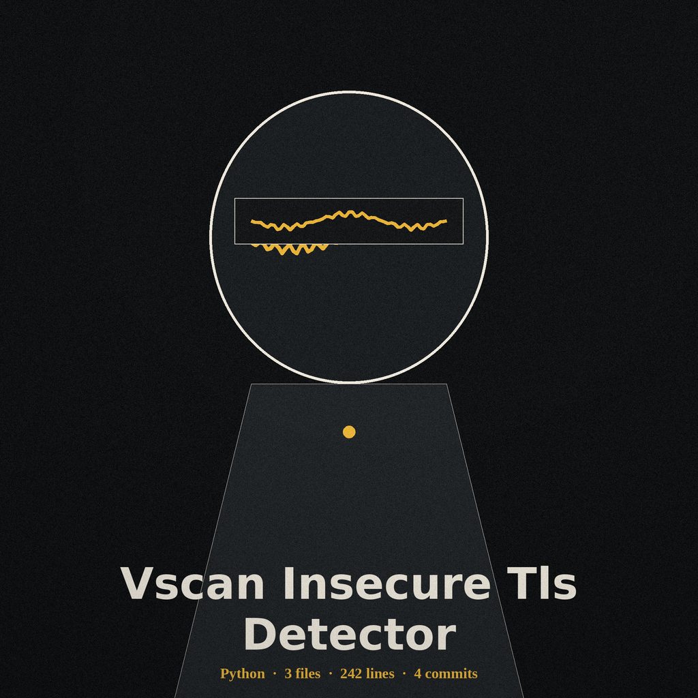
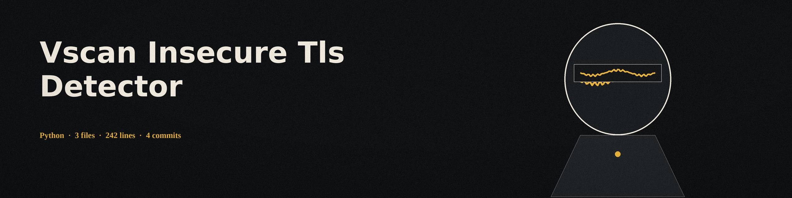

# vscan-insecure-tls-detector
A command-line tool that identifies potentially insecure TLS configurations (weak ciphers, outdated TLS versions, and certificate problems) on a target website or server.

## Install
`git clone https://github.com/ShadowGuard-AI/vscan-insecure-tls-detector`

Then install the dependencies: `pip install -r requirements.txt` (cryptography, pyOpenSSL).

## Usage
`python3 main.py <target> [options]`

The target may be a full URL (`https://example.com` or `https://example.com:8443`), a bare host (`example.com`), a bare host with port (`example.com:8443`), or a bare host with a path (`example.com/login`, where the path is ignored and only the host is scanned).

Examples:
- `python3 main.py https://127.0.0.1:8443 --timeout 5`
- `python3 main.py 127.0.0.1 --port 8443`

## Parameters
- `--port`: Port to connect to (default: 443). A port written in the target takes precedence over --port.
- `--timeout`: Timeout for connection attempts in seconds (default: 10).
- `--verbose`, `-v`: Enable verbose output for debugging.
- `-h`: Show help message and exit.

## Behaviour notes
Certificates are fetched with a non-verifying connection for inspection, so self signed, expired, not yet valid, and hostname mismatched certificates are reported as findings instead of blocking the scan. Self signed is decided by verifying the certificate signature with its own public key (on cryptography versions older than 42, which lack that check, issuer and subject string equality is used as a fallback). Each TLS version from 1.0 to 1.3 is probed with its minimum and maximum pinned to that version. Each of the six weak cipher suites in the built-in list (DES, 3DES, RC4, and export grade suites) is offered in turn under TLS 1.2, TLS 1.1, and TLS 1.0 shaped contexts; a suite the local TLS library cannot offer at all is skipped. If no check can be performed (for example the port is closed), the scan reports failure and exits non-zero instead of reporting a clean result.

## License
MIT (see LICENSE).
